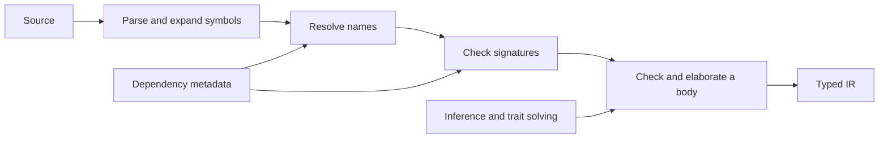

# Overview

Sage is a demand-driven Rust semantic frontend. Symbols give definitions stable
identities. Parsing and expansion create those symbols; resolution discovers
them; signature and body queries compute semantic products when requested.
Checking a body brings together name resolution, type inference, trait solving,
and elaboration into a completed typed tree.

This is a map of demand boundaries, not a mandatory batch sequence. Start with
[Crates](crates/README.md) to follow the modeled entities and operations.

- [Meta](meta/README.md) specifies how this book, its architecture language,
  source correspondence, and review system work.
- [Tenets](tenets.md) explains the principles behind the design.
- [Anchors](anchor/README.md) lists the specification's named claims with
  generated implementation and test status. Every rule has a page connecting
  its source definition, implementation excerpts, tests, and review.
- [Crates](crates/README.md) is a guided entry into the compiler model. Its
  subchapters render `.sage` declarations and their Rust implementations.
- [RFDs](../rfds/README.md) record changes, alternatives, rationale, and plans.
  Their normative changes are expressed directly in this specification.

Markdown and `.sage` are equally authoritative specification formats. Each
anchor states one independently testable claim. A source badge opens the
anchor's generated page; its context link returns to the definition.
**TODO** and **N/A** describe explicit implementation or test entries, not
successful verification. Evidence and status are generated from code, tests,
and saved reviews rather than maintained as a second specification.

For tool usage, start with the [User's Guide](../guide/README.md).
