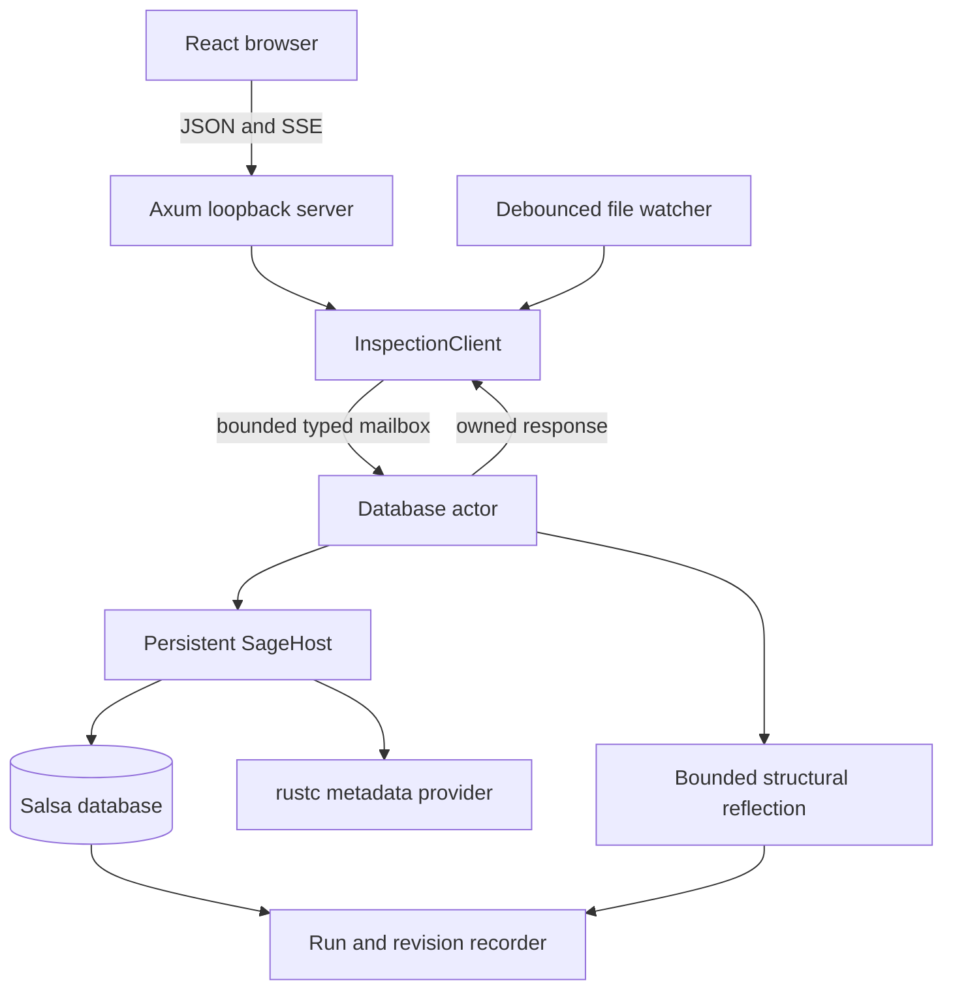

# Semantic Inspector

The Semantic Inspector is Sage's interactive code-review surface. Running
`cargo sage inspect` opens a local web application which browses the selected
crate's symbols, requests semantic products on demand, and shows the dynamic
Salsa and metadata work which produced each result. It is an observer of Sage;
the [Oracle Test Harness](../sage_oracle_harness/oracle-guide.md) remains the independent
exact conformance check.

## Inputs and outputs

The input is one selected Cargo target, its represented Rust source files, and
the reachable dependency metadata needed by Sage. The service retains that
workspace across requests and ordinary source edits. Its externally visible
outputs are:

- one complete, detail-free directory of represented local symbols;
- a selected local or external symbol with a positive list of available
  products;
- an owned generic render tree for one requested product;
- a bounded continuation for an omitted reflected subtree;
- the dynamic query/metadata tree for one inspection run; and
- retained revisions, exact input deltas, demanded runs, and comparisons.

The browser does not interpret Rust symbol kinds or product identifiers. It
interprets these generic resources and uses canonical paths supplied by the
server for navigation.

## Runtime architecture



Axum owns transport and embedded assets. It has no database handle and performs
no selection, semantic analysis, or reflection. A single actor serializes
typed requests, source edit batches, and workspace reloads. Ordinary `.rs`
changes update existing `SourceFile` inputs; Cargo or toolchain changes rebuild
the host and are reported as an explicit workspace-reload revision. The actor
then publishes Cargo metadata's authoritative workspace root together with the
selected package and source roots to the watcher. The watcher replaces its
non-recursive workspace/package and `.cargo/config{,.toml}` directory watches
and recursive source-tree watch before waiting for the next edit. Both
`rust-toolchain` filenames are configuration inputs. The command reports ready
only after these initial watches are installed; it does not infer either Cargo
root from a possibly nested target source path.

After reconstruction, replacement roots are installed before obsolete roots
are removed. A transient replacement-installation failure retains the prior
complete set, reports a structured degraded-watcher event, and retries. A
failed obsolete-root cleanup retains both old and replacement watches and
reports that harmless degraded state; it never sacrifices coverage of the new
source tree.

A live session owns exactly one Cargo library target. Multi-target workspaces
must select it with `--package`; the session preserves distinct Cargo package
and target names. Dependency preparation builds only that selected library and
collects all of its normal direct dependencies by Cargo package identity and
extern name, including dependencies which are also workspace members; an
unrelated broken member cannot block inspection. Reconstruction builds a
replacement before swapping it into the actor. The replacement's rustc
metadata thread must reach `after_expansion` without diagnostics and report
readiness before the host can be published. A malformed manifest, failed
build, or metadata-stub failure therefore returns a structured reload error
while the prior database, revision, and watch set remain usable.

```{anchor}
semantic_inspector_service_boundary
```

{spec}`crates.sage_inspector.inspection.workspace_actor`

Verification scenarios: Same-host cold/warm/relevant/unrelated edit tests
distinguish ordinary input revisions from database reloads and never expose
a partially applied batch.

{spec}`crates.sage_inspector.inspection.typed_service`

Verification scenarios: Service tests call the live provider directly;
black-box router tests start from a checked-in Rust project and cross the
actor and HTTP boundary. No handler accesses Sage directly.

The executable entry point constructs the live provider, starts the actor and
watcher, binds loopback port 2442 by default, and serves assets embedded with
`rust-embed`:

```{anchor}
semantic_inspector_command_entry
```

Expected startup failures are reported as CLI errors rather than panics. A
bind conflict points to `--port`; failure to open the default browser is only a
warning because the printed loopback URL and server remain useful.

## Protocol and generic browser

The normative `/api/v1` schema is recorded in the accepted [Semantic
Inspector RFD](../../../rfds/semantic-inspector/protocol.md). Every success and
error carries the process-wide revision ID and a request ID; resources which
do not exist are structured 400 or 404 responses. The server returns the only
valid products for a selected symbol, so an absent body is omission rather
than a synthetic “unavailable” product.

{spec}`crates.sage_inspector.inspection.source_evidence`

Verification scenarios: Backend and browser integration tests launch the
real command over the same sample project, drive production routes, and
snapshot the returned values, visible UI, and actor/query demand. A source
edit must change results only through the live database; no snapshot is read
as an API response.

{spec}`crates.sage_inspector.inspection.generic_browser`

Verification scenarios: Generic rendering component tests cover every
protocol node without semantic product IDs, source-driven browser tests cover
local and external navigation, and a static audit forbids product- or
symbol-kind dispatch in the client. Omitted products make no request.

{spec}`crates.sage_inspector.inspection.durable_navigation`

Verification scenarios: Direct-load, Back/Forward, replace-versus-push,
missing-target, event-reconnect, and revision-event tests inspect both the
restored view and API demand.

The local symbol directory is fetched eagerly because it is small identity and
presentation data needed for useful browser-local search. No signature, body,
field type, associated value, impl candidate, or callee body is part of that
resource. External metadata may be read only when macro resolution or
expansion requires it to determine generated local membership. If that
expansion cannot account for every possible child, the directory retains the
safe represented children and marks their parent explicitly incomplete.

{spec}`crates.sage_inspector.inspection.detail_free_index`

Verification scenarios: A real-workspace trace snapshots the closed set of
operation families used by directory construction, including the permitted
macro metadata families, and explicitly forbids signatures, bodies,
associated values, and impl discovery.

{spec}`crates.sage_inspector.inspection.product_availability`

Verification scenarios: Local/external catalog tests assert the exact
positive lists and forbid product-detail reads while constructing them.

## Canonical navigation

Local paths encode the selected crate and typed ownership segments. Named
segments include namespace/kind information; anonymous impl segments use a
stable header hash which excludes body, member, and span detail. External
roots include rustc's crate disambiguator and every structured definition-path
segment includes its kind, name, and disambiguator. Display labels are never
parsed to recover identity.

Links through anonymous entities are best effort across edits and inspector
restarts. Content-derived segments often preserve a link, but cannot reliably
distinguish identical occurrences across revisions: deleting one duplicate may
make its old link select another. This also affects descendants reached through
an anonymous ownership segment. The stronger stability guarantee applies to
paths with entirely named ownership segments. These navigation limitations do
not change the semantic identity of a definition reached through imports.

Inspector navigation deliberately has its own external-path projection. The
existing conformance projection omits anonymous rustc ownership segments where
both emitters omit them; canonical navigation retains those
segments so, for example, a variant and its constructor do not share an
address. Adding navigation detail must not change oracle output.

```{anchor}
semantic_inspector_external_paths
```

{spec}`crates.sage_inspector.inspection.canonical_ownership`

Verification scenarios: Path tests cover local association, anonymous and
generated ownership, reordered siblings, rename failure, reconstruction,
external parent/children, and crate disambiguation. The full exact oracle
suite separately proves that navigation-only path detail does not enter the
conformance representation.

## Semantic products and reflection

The current local function products are identity, source, expanded Concrete
IR, checked signature, diagnostics, and completed Typed IR. External products
are limited to independently available metadata such as identity, signature,
and children. Each product is requested independently and frozen into owned
protocol values before the actor replies.

A local product refreshes its symbol handle and any newly introduced reflected
cross-link by walking the symbol's explicit owner chain and enumerating only
siblings at those owner boundaries. It does not rebuild the recursive
directory or observe membership in unrelated descendant modules. This keeps
edited product requests correct without turning the eager search index into an
incremental dependency of every semantic product.

Ordinary structs and enums derive `Reflect`; the derive recursively preserves
every field and enum payload. Explicit implementations supply semantic names,
symbol cross-links, spans, stashed roots, and transparent arena-handle
projection. The context limits depth and node count. Repeated DAG edges are
expanded inline; only reentry into an entry currently on the reflection stack
produces an explicit cycle marker. A limit produces a frozen continuation
rather than silently dropping detail.

```{anchor}
semantic_inspector_reflect_derive
```

{spec}`crates.sage_inspector.inspection.owned_reflection`

Verification scenarios: Derive-shape, repeated-edge inlining, cycle-guard,
semantic-link, bounded wide-sequence traversal, representative real IR, and
continuation tests cover these cases.

{spec}`crates.sage_inspector.inspection.derive_reflection`

Verification scenarios: Compile/shape tests cover named, tuple, and unit
forms, real products retain their wrappers and nested type trees, and
continuation limits retain an explicit resumable boundary.

## Execution evidence

The workspace uses a temporary Salsa 0.26.1 fork. A tracked-function fetch
emits `WillRequest` before memo lookup and a balanced `DidRequest` with
`Executed`, `Validated`, `Reused`, or `Cancelled`. An RAII guard balances
unwinding. Sage database events and external-metadata operations are correlated
with that dynamic stack without per-query annotations.

Consecutive identical leaf requests are losslessly coalesced into one trace
node with an observation count. This preserves the millions of cache lookups a
solver run can perform without making the JSON tree itself millions of nodes.

```{anchor}
semantic_inspector_salsa_events
```

```{anchor}
semantic_inspector_salsa_request_guard
```

{spec}`crates.sage_inspector.inspection.balanced_traces`

Verification scenarios: Cold, warm, edited, nested, panicking, and
pre-fetch revision-cancellation tests assert balanced entry/exit and all four
terminal dispositions. Accumulator traversal separately proves that its
internal memo refreshes use the same lifecycle.

{spec}`crates.sage_inspector.inspection.unknown_work`

Verification scenarios: Real traces include all balanced Salsa requests
and metadata calls, and forbidden-demand tests cannot pass by filtering an
unknown node.

Analysis, reflection, and pure view assembly are explicit trace phases.
Reflection begins only after the requested semantic value is available, and
the run freezes before Axum serialization. The browser can filter, resize,
grow, collapse, and expand this already-owned tree without causing semantic
work.

{spec}`crates.sage_inspector.inspection.semantic_phase_boundary`

Verification scenarios: Phase tests inspect real products; generic
component tests interact with already-owned trees; and a source-driven
browser demand trace proves filtering, resizing, growth, collapse, and
expansion perform no semantic request.

{spec}`crates.sage_inspector.inspection.deterministic_trace`

Verification scenarios: Producer-authored sequential and unordered groups,
cold/warm/edit traces, and forbidden fallback assertions establish the
checked projection while raw debug payload remains available on failure.
Async group spans are poll-scoped so interleaved futures cannot corrupt
dynamic parentage.

## Revisions and edit experiments

A revision record contains input deltas and zero or more inspection run
handles. Applying an edit creates a revision but does not itself claim that a
semantic query ran. A run is added only when the browser or another client
demands work. Product comparisons report value change and observed differences
between executed and reused operation identities; they do not invent causal
invalidation edges Salsa did not report.

Within one live database, revision IDs contain Salsa's actual revision number.
A small database-generation component distinguishes a reconstructed host,
whose Salsa counter begins again, from the database it replaced. Each retained
summary also carries an explicit cause: initial workspace state, an identified
input-edit batch, or a workspace reload linked to the previous generation's
last revision and its structured reason.

{spec}`crates.sage_inspector.inspection.revision_and_demand`

Verification scenarios: Cold/warm/relevant/unrelated/reload tests inspect
revision details before and after demand and compare retained products and
traces across revisions.

## Implementation and test evidence

The generated [anchor pages](../../anchor/crates/sage_inspector/inspection.html) report implementation entries,
annotated tests, explicit TODO/N/A gaps, and saved claim/test reviews. These
associations do not themselves establish that a test ran.

The [earlier coverage snapshot](../../../rfds/implementation-sequencing/coverage-history.md#semantic-inspector)
preserves the former capability descriptions, edit experiments, and limitations
as historical evidence. Current coverage comes from the generated entries;
implementation plans and decision rationale belong in the relevant RFDs.
