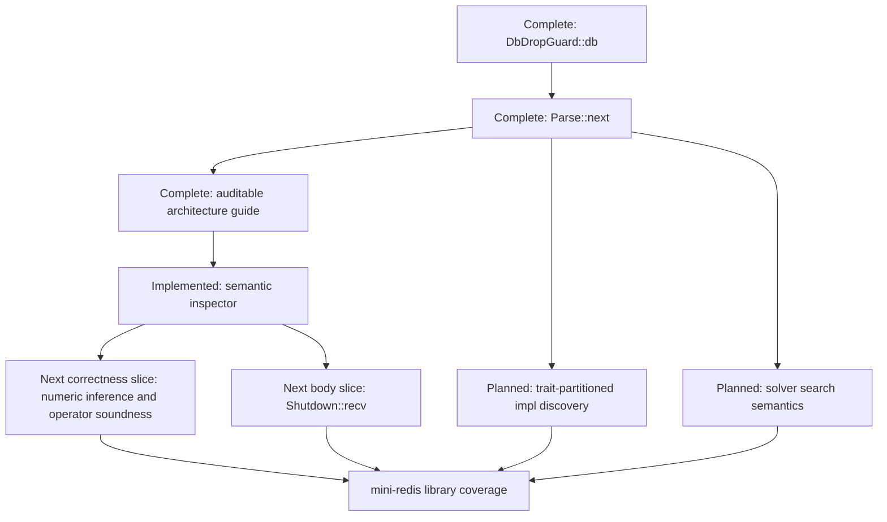

# Build-Out Roadmap

This roadmap answers: **what coherent semantic outcome are we building next?**
It is organized around cross-cutting implementation slices rather than around
source modules, architecture chapters, or individual RFD lifecycles.

A slice has an observable acceptance target and commonly changes several
phases and subsystems together. Architecture chapters describe each area's
destination and local **Current Status**. RFD `implementation.md` files own
detailed checkpoint lists. This page records the ordering and dependencies
between the larger outcomes.

## Sequence at a glance

Arrows express architectural or review dependencies, not a requirement that
all unrelated work stop. The Semantic Inspector is a review dependency for
future application slices even where the compiler feature itself could be
implemented without it.

## Completed slice: `DbDropGuard::db`

### Goal and acceptance target

Type-check the pinned mini-redis body `DbDropGuard::db` and emit a fully
elaborated static `Clone::clone` call that compares byte-for-byte with the
rustc oracle representation.

### Why this slice

This established the first end-to-end seam from source-associated function
identity through field resolution, derive-generated evidence, trait-method
lookup, fixed-trait proof, explicit adjustment elaboration, and exact oracle
comparison.

### Scope

The slice covers one ground, synchronous method call. It does not claim
general method resolution, arbitrary derives, borrow checking, or complete
Typed IR coverage.

### Affected architecture

- [Symbols and Semantic Identity](../design/infrastructure/symbols.md)
- [Type Checking](../design/checking.md)
- [Trait Solver](../design/trait-solver.md)
- [Typed IR](../design/typed-ir.md)
- [Oracle Test Harness](../design/oracle-test-harness.md)

### Implementation plan and progress

The slice is **complete**. Its detailed acceptance criteria, exact snapshot,
and cold/warm dependency evidence are recorded in [Mini-redis Slice 1][mini-1].
The accepted [Method Resolution] and [Typed IR Elaboration] RFDs continue to
generalize mechanisms first exercised here.

## Completed slice: `Parse::next`

### Goal and acceptance target

Type-check the pinned mini-redis body `Parse::next`, including external
`Iterator::Item` normalization and inherent `Option::ok_or`, with fully
elaborated typed IR and exact oracle identity.

### Why this slice

This forced solver operations to have goal-specific outputs and exercised the
global dependency-impl seam without widening the target to the whole crate.
It also pinned the dependency rule that normalization reads only the selected
associated value and no callee body.

### Scope

The slice covers one demanded associated type, represented external impl
metadata, and one rigid inherent call. It does not cover GATs, specialization,
opaque reveal, codegen dispatch selection, or complete local impl indexing.

### Affected architecture

- [Type Checking](../design/checking.md)
- [Trait Solver](../design/trait-solver.md)
- [Typed IR](../design/typed-ir.md)
- [Oracle Test Harness](../design/oracle-test-harness.md)

### Implementation plan and progress

The slice is **complete** through the [Associated Type Normalization RFD]. Its
acceptance and query-trace evidence are recorded in [Mini-redis Slice 2][mini-2].
The remaining local impl-index architecture is separated into the
[Trait Impl Candidate Discovery RFD].

## Completed slice: auditable architecture and review evidence

### Goal and acceptance target

Make the architecture book usable as a guide to the compiler: introduce the
phase/subsystem/representation taxonomy, explain symbols as the semantic
spine, give each chapter a destination contract plus Current Status/evidence,
and ground load-bearing mechanisms in source anchors.

The slice is complete when the phase and major subsystem entry guides exist,
the module-expansion pilot and one body-checking example have review packets,
and the book's maintenance contract enforces the new ownership model.

### Why now

The two completed mini-redis slices exposed that reviewing architecture by
reading implementation diffs does not scale. The guide and evidence model are
needed before broadening body coverage further.

### Scope and non-goals

This is a documentation and reviewability slice. It does not change compiler
semantics merely to make a phase contract look cleaner. Semantic discrepancies
found during the audit require their own decision or RFD.

### Affected architecture

All architecture navigation is affected. The primary contract is the accepted
[Auditable Architecture Guide RFD].

### Dependencies

The completed semantic slices provide real examples and evidence. The
Semantic Inspector now builds on that evidence model and provides its
persistent interactive review surface.

### High-level implementation plan

1. Establish navigation and documentation ownership.
2. Reshape the overview and document symbols.
3. Convert this roadmap to cross-cutting slices.
4. Pilot module expansion, then document the remaining phases and subsystems.
5. Connect existing tests and snapshots, then add Semantic Inspector commands.

### Progress

**Complete.** Phase and subsystem entry guides, destination/current-status
separation, the Symbols and incrementality guides, module/body review packets,
and the contributor evidence checklist have landed. The RFD's [implementation
plan][auditable-plan] records the completed checkpoints. The audit also pinned
the current coarse same-file body invalidation as evidence for later
incremental work.

## Implemented slice: semantic inspector and persistent edit testing

### Goal and acceptance target

Provide a `cargo sage inspect` web application with an Axum backend connected
to a live Sage database and a JavaScript frontend which fetches semantic
products on demand from a reusable typed service. Every semantic checkpoint
starts from a checked-in Cargo sample project and traverses the production
workspace host and live provider. Snapshots record returned values and demand;
they are not loaded as semantic responses.

Full-slice acceptance later adds complete structured query lifecycle capture
and cold, warm, relevant-edit, and unrelated-edit tests in one persistent
database. Checked traces use stable semantic event keys plus a stable unmapped
category; raw Salsa debug strings remain failure artifacts rather than golden
output.

### Why this slice is next

Architecture chapters can link existing unit tests and snapshots, but the
inspector turns review evidence into a consistent interactive workflow. It is
the practical bridge from reading a claim to inspecting output and incremental
dependencies.

### Scope and non-goals

The destination client is an Axum loopback backend and generic React
application over a reusable service. The frontend interprets a symbol
directory, positive product descriptors, and server-owned render trees without
encoding Sage symbol kinds or product meanings. Salsa lifecycle integration
follows real semantic products and cross-symbol navigation. Watch mode,
persistent revisions, and invalidation explanations follow lifecycle capture.
An LSP adapter is a later client. Human-readable rendering does not replace or
normalize the exact oracle representation.

### Affected architecture

- [Validation and Inspection](../design/validation/README.md)
- [Oracle Test Harness](../design/oracle-test-harness.md)
- [Symbols and Semantic Identity](../design/infrastructure/symbols.md)
- the incrementality guide introduced by the architecture slice

### Dependencies

- the architecture evidence vocabulary from the in-flight slice;
- stable backend-authored canonical symbol paths supplied by the complete local
  symbol directory and reflected semantic references; and
- the existing symbol-keyed semantic and external metadata boundaries.

The shell, symbol, product, and navigation checkpoints do not depend on
complete Salsa request hooks. Those are introduced only after the live
operation surface they must observe exists.

### High-level implementation plan

1. Add typed Rust DTOs, a database-owning actor reached through a typed client,
   Axum, embedded assets, the inspector command, and one eager detail-free
   local symbol index computed from a checked-in Cargo sample project.
2. Add real source, concrete, signature, body, and diagnostic products through
   derive-driven structural reflection, with custom implementations only for
   symbol links, spans, stashed values, transparent arena projection, cycle
   guards, and limits.
3. Activate canonical local/external navigation and dependency metadata.
4. Temporarily fork Salsa to add balanced spans for every tracked-query
   invocation before memo lookup, then expose the complete execution tree.
5. Add watching, coherent visible-demand refresh, persistent revision/input/run
   history, and edit comparisons. A revision mismatch discards all
   response-derived client state, bootstraps the current directory, and replays
   URL intent, retaining a clean future LSP boundary.

### Progress

**Operational, with browser-evidence and navigation gaps.** The typed actor
service, Axum loopback server, embedded generic React client, source-driven
backend snapshots, live local/external navigation,
derive-driven bounded reflection, temporary Salsa invocation spans, file
watching, explicit workspace reloads, and retained revision/edit comparison
are operational. The scripted provider and static API fixtures have been
removed. The living design and focused evidence are in the
[Semantic Inspector architecture chapter](../design/validation/semantic-inspector.md);
the RFD implementation page retains the detailed slice mapping. SI-A3/A4/A5/A7
remain partial until a headless browser drives the live sample-project server.
SI-A8 remains
partial: ordinary local and named external paths work, but replay through an
anonymous external impl would require a broader metadata lookup than the
current boundary, and invalid duplicate local definitions do not yet have
reorder-stable recovery addresses. Other current evidence limitations are
listed in that chapter.

## Next correctness slice: numeric inference and operator soundness

### Goal and acceptance target

Constrain unsuffixed numeric literals to the integer or floating-point type
families without selecting a concrete default, prove binary syntax through its
operator trait, and preserve every proven overloadable operation as a resolved
trait-method call in Typed IR.

Acceptance closes KD-7: `1 + true` produces a type diagnostic and recovery,
valid mixed-integer shifts such as `1u8 << 2i16` retain the left result type,
and primitive, generic, and user-defined operators become resolved trait calls.
Representative positive and negative cases agree with
the independent rustc oracle within this slice. An otherwise unconstrained
numeric literal remains unresolved and receives explicit diagnostic recovery;
it does not silently become `i32` or `f64`. Successful completed Typed IR
contains concrete types and no domain metadata.

### Why this slice

The literal checkpoint constrains an unsuffixed numeric literal so it cannot
become `bool`. Ground same-typed arithmetic without an applicable operator impl
is rejected, while successful non-lazy operators complete as resolved calls.
The remaining surface defect is concentrated in generic associated-binding
assumptions, unknown-`Self` candidate hints, and closure coverage.
Transactional inference, operator checking, diagnostics, canonicalization,
and Typed IR completion must still agree across that full matrix.

### Scope and non-goals

The slice covers suffixed and unsuffixed integer/float literals and binary
operator syntax currently represented by `BinaryOp`. Non-short-circuit syntax
uses the existing trait-solving and static-call elaboration boundaries, and
successful supported operations are represented as resolved calls. The ground
slice covers primitive operands and a representative user-defined operator;
generic associated-output assumptions remain out of scope. It does not add a
new general method lookup system or codegen primitive-specialization design.
Operator-specific hardcoded inference relationships are excluded.
Common-constraint extraction from ambiguous candidates is deferred to a
general inference-level design and must operate on the actual complete
candidate answers. Literal range lints, implicit numeric coercions, complete
casts, unary operators, and numeric defaulting also remain separate work.
Defaulting must be designed later as
part of a holistic inference-commitment policy rather than introduced through
scheduler-local quiescence.

### Affected architecture

- [Type Inference](../design/subsystems/type-inference.md)
- [Body Checking and Typed-IR Elaboration](../design/pipeline/body-checking.md)
- [Typed IR](../design/typed-ir.md)
- [Oracle Test Harness](../design/oracle-test-harness.md)

### Dependencies

The completed type-inference egraph and current `Binary` representation
provide the implementation base. The Semantic Inspector is useful review
infrastructure but is not a semantic prerequisite. Operator overloading reuses
the existing trait-call elaboration boundary. Primitive operator proofs use
ordinary `core` impls supplied by the existing external relevant-impl metadata
path; no primitive candidate is built into body checking or the solver.
Primitive lowering is deferred until future codegen has concrete substitutions
and is not a competing solver candidate. The [rustc binary-operator research]
records the reference pipeline that motivates this ordering and the
intentionally deferred answer-merging and fallback questions.

### High-level implementation plan

1. Land the source-neutral inference substrate: versioned equality-class
   domains, fallible domain-aware unification, and canonical round trips while
   every existing constructor continues to allocate `Any`.
2. Construct suffixed and domain-constrained literals, propagate
   proof-derived constraints, and diagnose unresolved numeric classes without
   defaulting them.
3. Add Sage-owned cached queries for the well-known operator items. Each query
   uses ordinary semantic lookup for a fixed `core`/`std` path—for example,
   the addition-trait query resolves `core::ops::Add`—and ordinary
   associated-item lookup for its method. A missing or ambiguous lookup is
   incomplete, not proof.
4. Replace blanket binary equality with retained operator-trait goals, import
   ordinary local or `core` impl responses through the existing candidate
   path, and elaborate every proven overloadable operation as a resolved trait
   call.
5. Add table-driven relation tests, source integrations, completed-IR checks,
   query traces, and exact oracle cases; then close KD-7 and promote the
   accepted RFD anchors with their evidence.

### Progress

**In progress.** The source-neutral domain substrate and numeric expression
literal checkpoint are operational: inference classes carry transactional
`Any`, `Integer`, or `Float` domains; suffixes lower directly; required source
conflicts report category-level diagnostics and recover once; unresolved
numeric classes do not default; and completed-IR tests cover generic and nested
ADT propagation plus rigid-head impl filtering after later narrowing. Cached
typed queries resolve all represented well-known operator traits and methods.
Every non-lazy token now instantiates that real method signature, retains its
ordinary proof and result-normalization work, and produces either a static
trait call or obligation-linked recovery; `&&` and `||` remain direct lazy
nodes. Source integrations cover ground `u32`, `f32`, and `f64` addition,
mixed-integer shift, comparison borrows, a local `Left + Right -> Sum` impl,
proof-derived narrowing of an unsuffixed operand, invalid and ambiguous
operator recovery, recovery isolation, both lazy boolean tokens, and cold/warm
`core` metadata reads. A representative independent oracle comparison matches
the supported successful primitive, comparison, local user-defined, and lazy
forms exactly; separate oracle coverage pins `NeverToAny` adjustment replay.
Explicit let annotations, the full propagation and operator matrix, generic
`T: Add<Output = T>` assumptions, and general unknown-`Self` candidate hints
remain open. KD-7 therefore remains open pending those cases and complete
oracle closure. The [implementation
chapter][numeric-plan] maps the remaining checkpoints to their code seams.

## Planned slice: trait-partitioned impl discovery

### Goal and acceptance target

Make impl discovery complete across the local crate and reachable dependency
crates while keying every lookup by trait and optionally a conservative rigid
self head. Edits to an unrelated trait's impl partition must not invalidate a
consumer whose relevant result is unchanged.

Acceptance requires query-trace and edit-invalidation tests for positive,
negative, and incomplete discovery, including proof that unrelated impl
headers, associated values, and bodies are not read.

### Why this slice

`Parse::next` established the semantic contract for global relevant impls, but
the current local backing query still scans expanded impl identities. Scaling
whole-crate checking requires the incremental dependency to match the semantic
trait key.

### Scope and non-goals

This slice indexes candidate identity and completeness. It does not implement
specialization, coherence, GAT normalization, codegen selection, or a general
self-type discrimination scheme beyond a conservative refinement.

### Affected architecture

- module expansion and its terminal completeness contract
- name resolution of local impl headers
- [Trait Solver](../design/trait-solver.md)
- the external metadata and incrementality guides introduced by the
  architecture slice

### Dependencies

The semantic query boundary and external relevant-impl lookup already exist.
The tracked map/lookup shape and edit evidence remain to be pinned by the
[Trait Impl Candidate Discovery RFD]. The Semantic Inspector is useful review
infrastructure but not a semantic prerequisite.

### High-level implementation plan

1. Pin the complete visible-impl and trait-key contracts.
2. Build stable local impl identity facts without lowering unrelated headers.
3. Partition lookup dependencies by trait and conservative self head.
4. Merge local and external completeness at the solver boundary.
5. Add persistent edit-invalidation and negative-dependency evidence.

### Progress

**Planned.** The RFD is Draft. The current solver has a trait-keyed public
query but not the required trait-partitioned local source dependency.

## Planned slice: solver recursion, scheduling, and monotone progress

### Goal and acceptance target

Define and implement cycle semantics, fair future scheduling, and optional
monotone intermediate result envelopes without making scheduler order affect
the final logical result absent resource exhaustion.

Acceptance includes grounded soundness/completeness modulo explicit overflow,
terminating sound behavior for non-ground queries, deterministic final results
across permitted schedules, and focused cyclic/fairness tests.

### Why this slice

The positive solver supports the completed ground slices, but its current
inductive cycle and active-frame behavior is not the agreed destination for
general recursive proof trees. Scheduling and cycle semantics must be designed
together before concurrency is broadened across conjunctions and alternatives.

### Scope and non-goals

This slice does not add negative reasoning, specialization, coinduction for
arbitrary traits, or codegen vtable/method selection. Overflow remains an
explicit resource outcome rather than a logical answer.

### Affected architecture

- [Trait Solver](../design/trait-solver.md)
- body obligation scheduling in [Type Checking](../design/checking.md)
- incrementality and inspection evidence

### Dependencies

The current canonical query/result boundary and future-based solver are the
starting point. The design work is split among [Cycle Semantics], [Scheduling
and Fairness], and [Incremental Trait Results]. Trait-partitioned impl
discovery is independently required for narrow candidate dependencies.

### High-level implementation plan

1. Settle inductive/coinductive cycle and fixpoint semantics plus resource
   limits.
2. Pin the proof-tree scheduling contract and meaningful yield points.
3. Define safe progress envelopes and subsumption.
4. Implement behind the existing goal-specific output boundary.
5. Test schedule independence, cyclic ground completeness, non-ground
   termination, and explicit overflow.

### Progress

**Planned.** All three RFDs are Draft. Research and destination tenets exist;
the current active-frame algorithm remains the implementation frontier.

## Next application slice: `Shutdown::recv`

### Goal and acceptance target

Type-check the pinned mini-redis async body `Shutdown::recv`, including an
external future-producing method, `IntoFuture`/`Future::Output` elaboration,
assignment, early return, and a high-level typed `Await` node. Sage and rustc
must again emit exact identical reference IR for the body.

### Why this slice

It is the smallest next mini-redis body that crosses the async/await and
future-output boundary without requiring whole-crate coverage. It extends the
same review discipline used for the first two slices.

### Scope and non-goals

The typed output retains `Await`; state-machine lowering and borrow checking
are deferred. Lifetimes remain `Dummy`.

### Affected architecture

- body checking and elaboration
- [Typed IR](../design/typed-ir.md)
- [Trait Solver](../design/trait-solver.md)
- external metadata
- [Oracle Test Harness](../design/oracle-test-harness.md)

### Dependencies

The auditable architecture slice supplies the review packet. The Semantic
Inspector is the preferred trace interface. Required `IntoFuture` and
`Future::Output` semantics must be pinned before implementation; unrelated
solver-search generalization is not automatically a prerequisite.

### High-level implementation plan

1. Pin the shared typed representation for the source body and `Await`.
2. Inventory the exact external signatures, projections, and obligations.
3. Implement the narrow future/await semantic path behind existing query
   boundaries.
4. Add typed-IR snapshot, exact oracle comparison, and cold/warm dependency
   evidence.
5. Update every affected architecture Current Status section in the same
   checkpoint.

### Progress

**Planned.** The target is specified in [Mini-redis Slice 3][mini-3]; a focused
implementation RFD has not yet been opened.

## Future slice: mini-redis library coverage

### Goal and acceptance target

Type-check every body in the pinned default-feature `mini_redis` library
target, emit no Sage diagnostics for the rustc-clean crate, produce no
unsupported typed nodes, and compare every shared body representation exactly
with the oracle.

### Ordering and dependencies

This is intentionally not one opaque implementation task. It follows the
reviewable body slices above and depends on the impl-discovery, solver, method,
Typed IR, metadata, and inspection capabilities demanded by the remaining
feature families. The [Mini-redis Conformance Roadmap] owns the finer
application ordering.

### Progress

**Future.** Library-wide acceptance has not started; two bodies are complete
and `Shutdown::recv` is the next pinned rung.

## Relationship to RFD status

Accepted and completed RFD lists remain in the book's RFD section. An RFD can
complete while the broader slice or destination capability remains partial.
Conversely, a slice may require several RFDs. Update this roadmap when a slice
is introduced, reordered, blocked, or completed; update an RFD implementation
file when one of its detailed checkpoints lands.

[mini-1]: ./mini-redis.md#slice-1-dbdropguarddb
[mini-2]: ./mini-redis.md#slice-2-parsenext
[mini-3]: ./mini-redis.md#slice-3-shutdownrecv
[Mini-redis Conformance Roadmap]: ./mini-redis.md
[Associated Type Normalization RFD]: ../rfds/associated-type-normalization/README.md
[Trait Impl Candidate Discovery RFD]: ../rfds/trait-impl-candidate-discovery/README.md
[Auditable Architecture Guide RFD]: ../rfds/auditable-architecture-guide/README.md
[auditable-plan]: ../rfds/auditable-architecture-guide/implementation.md
[Semantic Inspector RFD]: ../rfds/semantic-inspector/README.md
[Method Resolution]: ../rfds/method-resolution/README.md
[Typed IR Elaboration]: ../rfds/typed-ir-elaboration/README.md
[Cycle Semantics]: ../rfds/trait-solver-cycle-semantics/README.md
[Scheduling and Fairness]: ../rfds/trait-solver-scheduling/README.md
[Incremental Trait Results]: ../rfds/incremental-trait-results/README.md
[Numeric Inference Domains and Binary Operator Typing RFD]: ../rfds/numeric-inference-variables/README.md
[numeric-plan]: ../rfds/numeric-inference-variables/implementation.md
[rustc binary-operator research]: ../design/research/rustc-binary-operator-typing.md

## Architectural review language

**Goal and acceptance target:** Review compiler computations through `.sage`
methods with explicit dependency envelopes, with a parser and consistency
checker that identifies a forbidden dependency path.

**Scope and dependencies:** Builds on the auditable architecture guide. Covers
crate manifests, symbol and context declarations, and the central compiler
demand graph. Does not depend on changing Rust semantics or introducing an
executable specification of inference and trait proof.

**Progress:** Initial AST, parser, name/inheritance checker, conservative call
graph validation, CLI, and compiler model are implemented. The repository corpus
is tested as a closed set. See [Architectural Pseudocode](../design/validation/architecture-language.md)
for the checked contract and the distinction between model consistency and
implementation evidence.

**Value-type review:** Structured structs/enums and prose-defined opaque generic
types expose the key semantic types from `ty.rs`, with recursive type-expression
validation. Storage wrappers remain outside the review representation. Inert
Rust `#[sage::item(...)]` attributes link model declarations and methods to
implementation sites; explicit module anchors locate abstract concepts.

**Interactive review:** `sage-meta browse` exports a standalone HTML explorer
with searchable crate/module navigation, linked types, Rust annotations, and
method dependency/caller views. A collapsible Rust source pane maps model units
to annotated Rust declarations or module anchors and highlights their definitions. It reads a
validated snapshot; `sage-meta serve <port>` serves it on loopback. Neither mode
executes semantic queries or watches edits.

**Remaining coverage:** Refine per-kind identity and remaining grouped results; represent
context initialization and method parameters; expand grouped operations into
narrow source-backed methods; connect model edges to query-trace evidence.
Derive and harness internals currently have crate-level descriptions only.

## Architectural correspondence and runtime conformance

**Goal and acceptance target:** A real compiler test records architectural
operations, checks their declared permissions, and supplies a browser walkthrough
from the same evidence. Every model correspondence unit has a crate-correct
Rust `#[sage::item]` anchor; marker modules cover abstract concepts. Unexpected
calls fail checked tests rather than becoming silent gaps or automatically
permitted model changes. The book's Design chapter tree supplies the normative
specification through Markdown and `.sage` sources under `md/`, with
chapter-derived anchor names and required Rust implementation and test entries.
A hierarchical index shows rule text and status, including pending or
inapplicable work; each rule has a page linking context, implementation, and
tests or recorded evidence. The book and anchor system obey their own rules.
The shared `sage-meta` library checks these correspondences in CI and normal
workspace test runs.

**Scope and dependencies:** Builds on the review language above and the
Semantic Inspector's production provider and Salsa events. A source-index
prototype must establish reliable query provenance, including tracked methods,
generated code, and source/build compatibility first. Correspondence and runtime
checking do not depend on ACP or MCP. Canonical anchor pages and book integration
build on the existing specification-test index and standalone browser, and can
advance independently of full runtime enforcement. Agent integration follows
shared, scriptable model and trace tools.

**High-level plan:** Prove source-to-query matching; register inert tool
attributes and build a bidirectional index; migrate source links and remove
`#[rust]`; implement cached contracts and the checking engine; integrate Salsa
events, separate ordinary-function instrumentation, and async execution;
enforce a caller/callee fixture and expand coverage; replay traces in the browser;
then expose MCP tools and ACP-backed design/explanation workflows.

The anchor extension proceeds through specification and workflow review, a
shared Design chapter inventory with a `.sage` pilot, source relocation and
strict coverage, a hierarchical index and anchor pages, and integrated book
explorer navigation. Crates content from `design/crates/<crate>/*.sage` implements
the [browser display rules](../design/meta/book.md#displaying-sage-files), with
[direct links to every modeled entity](../design/meta/book.md#meta.book.entity_links).
Book, export, and local-server views share the validated model and renderer.
Entity links use model identities distinct from specification rule names. Anchor names follow full chapter source paths,
independently of headings; moves migrate references and redirect old URLs
without changing compiler model item identities. The detailed checkpoints remain in the
[canonical anchor extension plan](../rfds/sage-contracts/implementation.md#canonical-anchor-system).
Validation stays in the existing check and test entry points.

**Progress: Accepted, first infrastructure implemented.** The Rust correspondence
index covers crate/module headers, declarations, and declared methods; the
browser now derives links from that index and `.sage` Rust-origin annotations
are removed. Default `check --json` distinguishes model validity, Rust source
coverage, executable-declaration coverage, and named specification/test
coverage. The shared `sage_meta::check` entry point is called by the CLI and a
workspace integration test; the CI runner executes
`cargo run -p sage-meta -- check`. The architectural-language chapter introduces
fine-grained named rules and inert `#[sage::test(...)]` links. An immutable
resolved contract
engine and isolated real Salsa fixture check expected traversals and forbidden
requests, including cached requests and internal reexecution.

The [review checklist](../design/meta/reviews.md) snapshots each claim and its
complete annotated test set. The shared check rejects missing, stale, or
unsuccessful reviews; the review skill delegates semantic assessment and
records explicit reasoning. Reviewed TODO/N/A tests remain visible placeholders.

The expanded book and anchor contract is documented for review in
[The Design Book](../design/meta/book.md) and the architectural-language chapter.
Design-scoped inventory, chapter-derived names, generated Crates content under
`md/` with comprehensive entity links, Rust point/region references and their
placeholder classification, generated
index and pages, and integrated explorer navigation remain planned. The current
checker still uses explicit anchor names and the model remains under
`sage-src/`; specification placeholders do not establish the planned behaviors.

See [Sage Contracts and Walkthroughs](../rfds/sage-contracts/README.md) and its
[staged implementation plan](../rfds/sage-contracts/implementation.md). Full
caller/callee body acceptance, ordinary-function and async instrumentation,
source/build configuration identity, browser replay, and agent adapters remain.
Static call analysis and dynamic field-read/context-creation checking are
further work. Complete source coverage does not establish runtime conformance.
