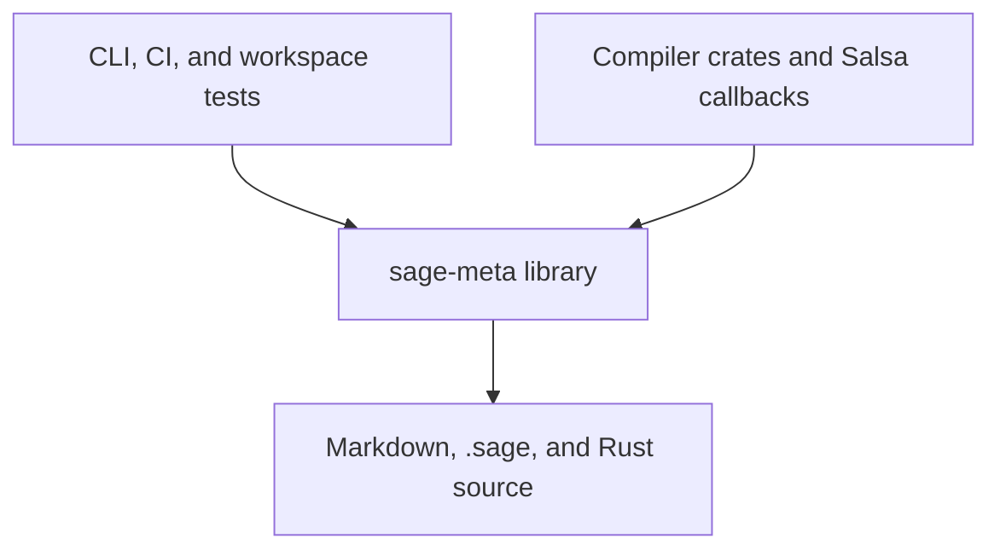

# Sage correspondence, runtime contracts, and walkthroughs

**Status: Accepted; implementation in progress.** Source correspondence and the
browser have migrated to inert Rust attributes. A shared checking engine and
isolated real Salsa fixture establish the first runtime infrastructure. The
shared workspace check also validates named Markdown specification rules and
their test references, and runs in CI and Cargo tests. The accepted extension
makes the book's Design chapter tree authoritative, using both Markdown and
`.sage` sources, connects rules to Rust implementation excerpts, and gives every
rule an anchor page. That extension, broad compiler enforcement, walkthrough
replay, and agent integration remain
staged work; see [Implementation plan and status](implementation.md).

## Motivation

The architecture model should support design discussion, explanation of real
compiler behavior, and checking implementation conformance. Those activities
should share operation identities and evidence. An observed call can explain
a compilation step and establish whether that step respects its envelope.

The original model checked its own consistency and used `.sage` `#[rust(...)]`
annotations for best-effort source navigation. This change replaces that mapping
with Rust-declared correspondence and connects observed Salsa requests to the
architectural contract. Complete implementation coverage remains distinct from
source coverage and from successful observations of a limited fixture.

## Specification changes at a glance

The pending book and anchor extension needs the following changes. These links
lead directly to the normative Design diff; the RFD explains the rollout and
tradeoffs rather than introducing another copy of the rules.

| Needed change | Design contract |
|---|---|
| Make the Design chapter tree authoritative and apply the same rules to the book system itself | [Authority](../../design/meta/book.md#meta.book.authority), [self-description](../../design/meta/book.md#meta.book.self_description) |
| Present searchable, interlinked Crates content from `design/crates/<crate>/*.sage` with specified browsing, source panes, and navigation | [Displaying Sage files](../../design/meta/book.md#displaying-sage-files), [browser delivery](../../design/meta/book.md#meta.book.browser_delivery), [crate ownership](../../design/meta/book.md#meta.book.crate_ownership) |
| Give every modeled entity a direct link that prose and other model content can reference, using model identities independently of specification rule names | [Entity links](../../design/meta/book.md#meta.book.entity_links) |
| Derive names from the complete chapter source path relative to Design plus local rule names, independently of headings | [Chapter names](../../design/meta/book.md#meta.book.chapter_names), [moves and redirects](../../design/meta/book.md#meta.book.anchor_moves) |
| Require implementation and test entries with explicit TODO and N/A accounting, and extract Rust points or regions | [Implementation coverage](../../design/meta/anchors.md#meta.anchors.implementation_coverage), [test coverage](../../design/meta/anchors.md#meta.anchors.test_coverage), [placeholder status](../../design/meta/anchors.md#meta.anchors.placeholder_status) |
| Generate the grouped text/status index and linked rule pages | [Index rows](../../design/meta/book.md#meta.book.index_rows), [grouping](../../design/meta/book.md#meta.book.index_groups), [status labels](../../design/meta/book.md#meta.book.index_status), [anchor pages](../../design/meta/anchors.md#meta.anchors.anchor_pages) |
| Review RFD rationale and the normative Design edits together, then preserve direct links through the book and explorer | [RFD changes](../../design/meta/book.md#meta.book.rfd_changes), [explorer navigation](../../design/meta/anchors.md#meta.anchors.explorer_navigation) |

The [HTML interaction sketch](anchor-index-sketch.html) illustrates the
proposed index and anchor-page navigation using example data. It is a review
artifact, not implemented book generation or evidence of coverage.

## Correspondence is declared in Rust

Replace `.sage`'s `#[rust(...)]` with inert Rust tool attributes,
`#[sage::item(...)]`. Register the namespace on the repository's pinned nightly.
These attributes have no procedural macro and generate no code; the loader
parses the original Rust sources to interpret them. For example:

```rust,ignore
#![feature(register_tool)]
#![register_tool(sage)]

#[sage::item(crate::symbols::LocalFnSym)]
struct LocalFnSym { /* existing fields */ }

#[sage::item(crate::checking::BodyCheck)]
mod r#abstract {}
```

The argument names a Sage item, not a Rust path. `crate` identifies the modeled
crate containing the Rust annotation. Fully qualified targets, if supported,
must still identify that same crate. Resolve ownership through Cargo package
and target metadata, not directory names or `module_path!()` string guesses.
Library and binary roots must both be scanned where a package contains both.

One Sage item can correspond to multiple Rust items. A concept spread across
implementation modules can use an annotated module, including an empty
`mod r#abstract {}` in `lib.rs`. A module is a location anchor; it neither
introduces a runtime frame nor implicitly maps all descendant operations.
There is no "no Rust location" exemption, including for abstract concepts.
Primitive or external representations can use local marker modules too.

Non-executable anchors may carry multiple Sage correspondences: `SymExt`, for
example, currently represents several external symbol classes. Instrumented
functions should have one operation identity. If two modeled layers currently
name the same function, choose the actual boundary or refine the model rather
than fabricate nested invocations with repeated attributes.

The proposed initial correspondence units are crate/module headers, named
type/class/context declarations, and explicitly declared methods. Crate and
module headers use annotated Rust modules or marker modules. Fields, variants,
generic parameters, and envelope clauses remain parts of their containing
declaration, not independently required correspondence units. Confirm this
granularity before migration; report it explicitly in coverage output.

Concrete methods require function/method implementation mappings before they
can count as dynamically checked. Abstract methods can map to trait method
declarations or marker modules; their concrete overrides need executable
mappings. Multiple implementation sites are valid; contradictory targets or
incompatible executable kinds are errors. Abstract mapping does not grant
permission to skip validation of the target's existence or crate ownership.

<a id="sc-a1"></a>

Source correspondence is specified by
[`meta.contracts.correspondence`](../../design/meta/contracts.md#meta.contracts.correspondence),
including bidirectional coverage and Cargo ownership.

Start with a source index that understands annotation sites rather than
guessing Rust targets from names. Record declaration range, annotation range,
Cargo owner, Rust item kind, cfg predicates, and whether a site comes from a
known macro input. Source coverage across configurations is distinct from the
active compiled instrumentation inventory. An inactive cfg branch must not
make a missing active operation look instrumented. Do not interpret arbitrary
macro token text as proof of generated Rust declarations.

The browser derives its source links from this index, supports multiple sites,
and labels abstract markers. Remove `#[rust]` parsing, AST nodes, and old
resolution heuristics after the repository corpus has migrated; temporary dual
support exists only to make the migration reviewable.

## Shared validation and specification tests

`sage-meta` owns the build-time correspondence checks among Markdown
specifications, `.sage` declarations, and Rust. A public
`check(workspace_root)` returns a report containing model consistency, source
correspondence, specification-test coverage, and current review decisions;
`ensure_valid()` rejects
errors. The default CLI `check` command, CI runner, and workspace Cargo
integration test use this same library entry point. `check_model(model_root)`
selects a model directory and performs the full check in its containing
workspace. Model-only consumers retain the legacy positional CLI invocation
and the library's `workspace::load_documents` and `validate` APIs.

Use a local MyST-style <code>{anchor}&#96;calls.declared&#96;</code> marker at the start
of a specification paragraph in `design/meta/language.md`. Its chapter-derived
identity is `meta.language.calls.declared`; an inert
`#[sage::test(meta.language.calls.declared)]` attribute references that full name
from each test covering it. Names describe independently testable rules and do
not depend on paragraph order. Each anchor has at least one test; all
test references resolve to a rule and occur on tests. Duplicate/malformed
anchors, missing tests, and dangling/misplaced references fail the shared check.
Tests may cover multiple rules across crate boundaries. Evidence must be a
non-ignored module-level function with the built-in `#[test]` attribute in a
Cargo target with tests and the standard harness enabled; `test = false` and `harness = false` targets cannot supply it.
The inventory includes cfg alternatives without claiming those tests executed
or their assertions are sufficient. A small mdBook preprocessor renders these markers with the same
parser; full MyST support is unnecessary.

The architectural-language chapter and its existing language/runtime tests use
these named rules. The [contract rules](../../design/meta/contracts.md) connect
correspondence and runtime guarantees to their implementation and tests.
Source correspondence and runtime coverage remain separate requirements.

## Incremental review checklist

Annotation coverage cannot determine whether a test meaningfully checks the
claim it names. A committed `review-checklist.json` makes that judgment an
explicit review step while allowing unchanged claim-and-test inputs to reuse
a completed decision. The [review specification](../../design/meta/reviews.md)
defines the extracted text, complete test-set input, stale decisions, and CI
gate; the [implementation checkpoint](implementation.md#review-checklist)
tracks the work.

The repository skill prepares only pending work, assigns related claims to
review subagents, and records reasoned decisions after checking every assigned
claim. The test body should make its scenario, expectation, and assertion
visible. This keeps the cached review useful without trying to infer a Rust
call graph for all test helpers. Explicit helper inputs can be added later
when a meaningful check cannot be made visible in the test body.

The checklist records the actual source text rather than only hashes, so the
Git diff shows exactly what was approved. Preparing work cannot refresh an old
approval, and recording rechecks inputs to avoid accepting a review against
changed sources. Reviewed TODO and N/A entries preserve explicit planning
status; the gate requires their accounting without pretending that a dummy
test establishes behavior. Running tests and checking runtime conformance
remain separate.

## Canonical rules and anchor pages

The mdBook Design chapter tree is the normative specification. Markdown and
`.sage` are equally authoritative chapter source formats within the book source
directory (`md/`); `.sage` chapters live under a directory identifying their
modeled crate, with a `crate.sage` manifest. The Crates section presents
searchable, interlinked content from `design/crates/<crate>/*.sage` following the
[browser specification](../../design/meta/book.md#displaying-sage-files).
[Browser delivery](../../design/meta/book.md#meta.book.browser_delivery) shares
that behavior across book generation, standalone export, and local serving.
The full chapter source path relative to Design supplies an anchor's namespace,
combined with its local rule name. Headings contribute nothing to that name.
A chapter move therefore renames its anchors and requires reference migration
and redirects for old URLs. It does not change compiler model item identities.

Every modeled entity has a direct link usable from elsewhere in the book or
model: types, classes, contexts, explicit methods, and modeled crates and
modules. These links resolve through model entity identities, independently of
paragraph anchor names. Providing a link does not automatically declare a
specification rule or impose paragraph-rule coverage on that entity. The
[entity-link contract](../../design/meta/book.md#meta.book.entity_links) fixes
that behavior. Source chapter links retain the selected entity through its
`#item:<model-identity>` route; specification references use
<code>{spec}&#96;full.rule.name&#96;</code>.

The book generates a hierarchical index of rule text and status, as well as a
page for each rule connecting its definition, context, Rust implementation,
and tests or recorded evidence. Unfinished entries display **TODO**; inapplicable
entries display **N/A**. The existing Rust-to-Sage item mapping remains
a separate relationship. The rationale is recorded in
[The Design book is the canonical specification](../architectural-foundations/README.md#the-design-book-is-the-canonical-specification).

The living specification is [The Design Book](../../design/meta/book.md), with
point and region references, coverage, placeholder accounting, and navigation
specified in
[Architectural Pseudocode](../../design/meta/anchors.md#specification-tests-and-workspace-checks).
Existing mdBook explanatory excerpt delimiters remain independent. The anchor
system specifies itself using these same rules and coverage requirements;
it has no privileged exceptions. Shared CLI, CI, and workspace-test validation
remain the entry points, without a `cargo build` hook.

This RFD records rationale and rollout checkpoints on the same branch as the
normative Design edits. The specification does not wait for implementation or
RFD completion to become authoritative, and completion does not promote a
second specification from the RFD. Implementation status and explicit
placeholders show what remains unbuilt.

The [implementation checkpoints](implementation.md#canonical-anchor-system)
record the inventory, source relocation, coverage, page generation, and
navigation work. Definitions in Markdown and `.sage` prose now use local
anchor names; references use full names. Chapter paths establish namespaces,
and conflicting nested placeholder statuses are rejected. The Design chapters
specify those conventions. Ingestion of executed-test and trace evidence remains
separate work; source associations do not imply observed results.

## Runtime model and crate boundaries

Runtime checking belongs to the `sage-meta` library alongside its model,
source-index, and workspace-check APIs:



Correspondence annotations add no Cargo dependency and can be used by
`sage-meta` itself or a future proc-macro crate without bootstrap cycles.
`sage-meta` never depends on `sage-ir`; its Salsa adapter is optional.
HTTP/browser dependencies should also be optional for model-library consumers.
A separate runtime crate is no longer part of the plan.

Inert annotations do not instrument ordinary functions. A separate opt-in
mechanism must eventually supply their entry/exit events. Its implementation
(explicit guards, a distinct instrumentation macro, or another mechanism) is
not yet selected. Keep contract loading and validation outside recursive
self-enforcement.

Expose a reusable resolved model from `sage-meta`: stable operation IDs,
resolved dispatch, permitted calls, inherited prohibitions, and diagnostics.
The CLI, runtime, browser, and agent tools use those same rules. Browser code
must not become the authority for a second implementation of enforcement.

Load `.sage` sources and index `#[sage::item]` sites in `.rs` sources once per
checking session, caching the validated contracts and correspondence index.
Record a model digest and the correspondence/source revision
with every trace. Tests may construct isolated sessions to exercise different
models. Normal compiler tests share an immutable session. Source edits take
effect on the next session; there is no live reload within a test run.

Model discovery needs an explicit override plus a reliable workspace default,
independent of the process's current directory. Enforced tests fail clearly if
the model is absent or invalid. Do not silently fall back to unenforced mode.
Use a dedicated test/check configuration; enable it in standard development
test entry points once the covered compiler slice is complete. Release policy
and overhead measurement are separate from the inert-annotation rollout.

<a id="sc-a2"></a>

The session contract and its verification cases are specified by
[`meta.contracts.validated_session`](../../design/meta/contracts.md#meta.contracts.validated_session).

## Operation entry, recursion, and Salsa

For ordinary functions, the separately selected instrumentation mechanism
will provide entry/exit events to check calls and record architectural frames.
Uninstrumented helpers retain the active frame.
Calls between two Rust functions mapped to the same Sage operation are
architectural recursion and require a corresponding permission.

Interface dispatch needs an explicit rule before instrumentation. The Rust
`FnSymbol::sig` dispatcher implements an abstract Sage method and calls a concrete
`LocalFnSym::sig`; abstract methods currently have no envelope. The proposal is
to represent a dispatch frame with permission to enter its known override,
while checking the caller's interface permission and inherited prohibitions.
Prototype and review this rule against external dispatch and recursion; do not
drop either real function call merely because one is an interface boundary.

For queries, join Salsa's structured ingredient identity and source location
to the annotated declaration in the loaded source index. No Sage operation ID
is compiled into a query by the inert attribute. Salsa owns query expansion,
including tracked impls, borrowed returns, and generated query APIs.

The early prototype must establish location fidelity for free queries, tracked
methods, generated declarations, shared expansion sites, and cfg alternatives.
Account for path remapping and loaded sources differing from the compiled
binary. Cache successful ingredient-to-operation matches per database/session;
reject missing or ambiguous matches. Do not fall back to debug-string matching
or credit an inactive cfg anchor as an active match.

Salsa already stores query file/line information, but its callback currently
receives only an event. Expose sufficient source provenance through callbacks
or a safe lookup API. If existing locations are insufficient, establish richer
provenance before claiming conformance; explicit compiled operation metadata
is a fallback to revisit, not the chosen design.

Inert attributes can survive or be duplicated by macro expansion without
generating duplicate instrumentation. Known generators still need traceable
source provenance. This approach requires neither outermost Sage attribute
ordering nor custom query wrappers.

Check request events before presentation coalescing. Unknown requests remain
unmapped rather than being attributed to the top frame.
An enforcement failure inside a Salsa callback must preserve balanced lifecycle
events: the current request notification precedes construction of its request
guard. Prototype safe failure reporting or adjust that lifecycle before allowing
callbacks to unwind through it.

Salsa's internal validation can reexecute dependencies without an ordinary
source request. Add balanced execution context where necessary and associate
the executing ingredient with its indexed Sage operation. Distinguish source
requests from dependency verification and accumulator traversal; the latter
must not become fictitious direct calls by the active operation. A request and
its execution are related events, not two architectural invocations. A warm
result exposes no new internal execution; historical dependency evidence
requires explicit retention, not an invented trace.

<a id="sc-a3"></a>

Invocation preservation across caching is specified by
[`meta.contracts.cache_invocations`](../../design/meta/contracts.md#meta.contracts.cache_invocations),
including the required lifecycle and traversal evidence.

Check immediate callers against permitted dispatch and all active ancestors
against transitive prohibitions. Carry invocation IDs, operation IDs, receiver
identity where required, source sites, parentage, and outcome. `self` permissions
need the same receiver, not merely the same class. Use identity stable within
the database/session; do not compare rendered names or storage addresses.

The synchronous stack can be thread-local with unwind-safe guards. Async
operations require context installation on poll and removal before suspension;
task migration and spawned work need explicit context propagation. Until that
exists, reject unsupported async instrumentation rather than hold a TLS frame
across an await. Report contract violations without causing a second panic
during unwinding; the enclosing checked test must still fail.

## What a check establishes

Model consistency, correspondence coverage, and observed runtime conformance
are separate results. Marker coverage does not establish executable coverage.
Observed passing tests establish only the operations and scenarios they cover.

<a id="sc-a4"></a>

The acceptance boundary is specified by
[`meta.contracts.observation_coverage`](../../design/meta/contracts.md#meta.contracts.observation_coverage):
reported gaps cannot be treated as proof of conformance.

Initial enforcement covers operation calls and transitive prohibitions.
`reads` and `creates` require their own input/access/construction hooks and
must be reported as not yet dynamically checked. Arbitrary unannotated ordinary
helpers cannot all be discovered by query callbacks; source inventory and later
static analysis address that limitation. Never broaden an envelope automatically
just to make an unexpected observed call pass.

## Walkthroughs and agent workflows

### Infrastructure test fixtures

Keep the controlled contract fixtures under `sage-meta`, separate from the
compiler's architecture corpus. Proposed layout:

```text
crates/sage-meta/tests/
  contracts.rs
  fixtures/contracts/
    Cargo.toml
    book.toml
    src/lib.rs
    md/SUMMARY.md
    md/design/crates/sage_contract_fixture/crate.sage
    expected/
      allowed.trace
      forbidden.diagnostic
      cached-forbidden.diagnostic
```

The fixture uses ordinary Sage declarations such as `TestRoot::run`,
`TestHelper::work`, and `TestLeaf::read`, with corresponding inert annotations
on real Rust functions/queries. There is no test-only node kind in the language.
The integration harness loads these sources through the production indexing,
model validation, and event-checking paths. Use an isolated fixture Cargo
workspace with the same vendored Salsa; do not add fixture nodes to the compiler
model or require a compiler dependency in the `sage-meta` library.

Hand-reviewed expectations specify operation IDs, parentage, receiver identity,
cache outcomes, and independently expected Rust declaration sites. Choose some
Rust names different from the Sage names. Swapping valid annotations must break
the expected traversal; missing or ambiguous mappings must not disappear from
the output. Normalize incidental paths/IDs without hiding unmatched events or
meaningful ordering.

For the negative fixture, a valid model permits `TestRoot::run` to call
`TestHelper::work`, forbids `TestLeaf::read` transitively from the root, and
declares no helper-to-leaf edge. Real Rust code deliberately requests the leaf
from the helper. Assert both the undeclared edge and the ancestor prohibition,
including its rule and complete call path. Repeat after prewarming the leaf as
an allowed root request: cached results must not evade request checking.

Static consistency already rejects a permitted path to a forbidden operation,
so this runtime failure necessarily includes an undeclared edge. Unit-test the
ancestor matcher separately instead of weakening model validation to isolate
it. These fixtures establish infrastructure behavior; the real compiler
scenario below separately establishes production correspondence.

### Real compiler evidence and agent access

The first acceptance scenario starts from a checked-in Rust test project:
checking one caller may request a callee's signature but not its body. Record
cold and incremental runs. A deliberate forbidden request must fail and leave
an inspectable diagnostic/trace. Use the existing Semantic Inspector's real
compiler provider rather than introducing a second mock compiler pipeline.

The browser then replays those events, linking `.sage` operations, Rust sites,
the input program, cache outcomes, and the permission or prohibition involved.
Distinguish a model's permitted graph, observed execution, and agent predictions.
Neither prose nor an envelope specifies a deterministic execution sequence.

Expose transport-independent operations for model lookup, correspondence,
validation, fixture execution, trace retrieval, and violation explanation.
CLI and browser consume them first; an MCP adapter exposes them to agents.
`sage-meta serve` can subsequently act as an ACP client through its server-side
host, carrying the selected item, test, model digest, and trace in an agent
session. ACP manages conversation; MCP supplies tools. Agent availability must
not be required to run invariants in CI.

Add skills/workflows for reviewing a proposed model change, explaining a real
fixture, and triaging a conformance failure. A design review should show an
envelope diff, affected callers, and matching evidence before implementation
changes. An explanation must cite observed events or label predictions. An
agent may propose a contract change but cannot treat it as already agreed.

Protocol adapter choice and exact MCP schemas follow the stable local tools;
they are not prerequisites for correspondence or runtime enforcement. Broader
static call analysis and formal Rust semantic rules are later work.

## Implementation

See [Implementation plan and status](implementation.md) for independently
reviewable stages and acceptance checks. Keep the Design rules for source
correspondence and runtime evidence current with implementation changes; this
RFD retains their rationale, macro mechanics, protocol choices, and sequencing.
